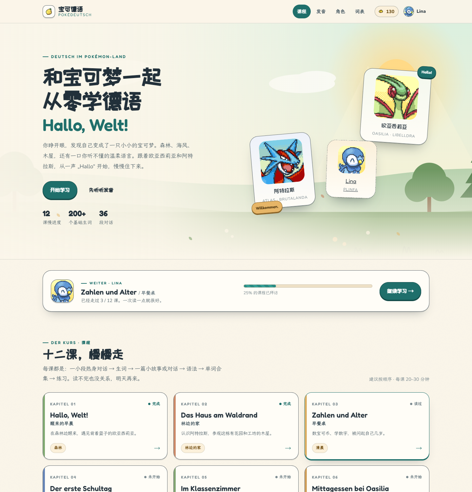

# 宝可德语 · PokéDeutsch

一个「只有宝可梦、没有人类」的世界里的德语零基础学习小站。

**在线访问（GitHub Pages）：** https://arcarlight.github.io/Deutsch-learning-flygonish/



你睁开眼，发现自己变成了一只宝可梦。森林边住着 17 岁的沙漠蜻蜓**欧亚西莉亚**和 20 岁的暴飞龙**阿特拉斯**；白天你要去稳重的电龙**利希特老师**那里上课，同桌是害羞的**米拉**（土龙弟弟），还有总想飞的**阿尔科**（始祖小鸟）、自来熟的**艾米**（电飞鼠）和爱恶作剧的**薇丝**（风妖精）。

一共 12 课，节奏很慢，只讲日常。每课包含：

0. **热身小对话**（在生词之前：一小段问答引出本课句型，并展示动词/结构的变形，点例句可听）
1. **生词**（带 IPA、例句、点读）
2. **课文**（两篇对话/小故事，德语 + 中文对照，可一键隐藏中文）
3. **语法**（1–2 个点，带变位表/例句）
4. **单词合集**（可打印）
5. **练习**（6–10 题：选择、填空、语序、配对、听力、判断）
6. **世界小记** + 本课新朋友

另外有独立的**发音页**、**角色图鉴**和**全部单词表**。

---

## 怎么打开

### 方式一：双击 `start.bat`（推荐）

会自动启动一个本地小服务器并打开浏览器，地址是 `http://127.0.0.1:4321/`。关闭黑色窗口即停止服务器。

需要电脑上装有 Node.js（你机器上已经装好了 v24）。

### 方式二：直接双击 `index.html`

也能正常阅读、点读和做题；进度保存在浏览器的 localStorage 里。少数浏览器对 `file://` 的存储限制较严，如果发现进度不保存，请用方式一。

### 方式三：命令行

```bash
node tools/serve.mjs 4321 --open
```

---

## 目录结构

```
index.html            首页：世界观、课程地图、选伙伴
lektion.html?l=1      课文页（1–12 课）
aussprache.html       发音规则
charaktere.html       角色图鉴
woerterbuch.html      全部单词（搜索/筛选/点读）
css/                  base / home / lesson / pages
js/                   app（共享）/ home / lesson / aussprache / charaktere / woerterbuch
data/lessons/01–12.js 课文数据（每一课一个文件）
data/characters.js    角色档案
assets/portraits/     90 张 PMD 头像（10 个角色 × 9 种表情）
assets/fonts/         Fredoka / Nunito / 霞鹜文楷（子集）/ 站酷快乐体（子集）
assets/img/           宝可币、文柚果图标、favicon
docs/                 故事圣经、课程大纲、数据格式说明
tools/                本地服务器、校验、字体子集、素材下载脚本
```

## 动词是怎么一点点教的

- **第 1 课**：先认「原形 → 词干 → 词尾 / 变位」这一套格式，只要求记住最特殊的 `sein`，并用 `kommen` 预览一下规则动词长什么样。
- **第 4 课**：系统学规则动词现在时的词尾 `-e / -st / -t / -en / -t / -en`。
- **第 5 课**：`haben`；**第 6 课**：`möchten`；**第 9 课**：情态动词 `können / wollen / müssen`；**第 11–12 课**：可分动词的框型结构。
- 每课课文前的「00 热身」里也会先展示本课动词的变位，点例句可以听。

## 进度与宝可币

- 选好伙伴、起好名字后，名字会出现在课文和练习里（`{{name}}` 占位符）。
- 三个伙伴各有一个默认德文名：火稚鸡 **Frido**、波加曼 **Lina**、木木枭 **Theo**。也可以起自己的中文名或英文名；没选伙伴时课文里暂时用 Lina。
- 读过的课、做对的练习、拿到的宝可币都存在本机浏览器，不上传。
- 练习第一次答对 +10 宝可币，之后再答对 +3，答错不扣。完成一课再 +20。
- 宝可币目前**没有任何用途**，只是一个数字——就像小时候攒的漂亮石头。

## 想改内容？

课文是纯数据文件，格式见 [`docs/schema.md`](docs/schema.md)，写作规则见 [`docs/story-bible.md`](docs/story-bible.md)，每课教什么见 [`docs/curriculum.md`](docs/curriculum.md)。

改完运行校验：

```bash
node tools/validate.mjs            # 全部 12 课
node tools/validate.mjs 03 04      # 只校验指定课
```

重新裁剪中文字体（如果新增了很多汉字）：

```bash
pip install fonttools brotli
node tools/fetch-fonts.mjs      # 若 tools/fonts-src 里没有字体源文件
python tools/subset-fonts.py
```

## 素材与致谢

- 宝可梦头像：[PMD Sprite Repository](https://sprites.pmdcollab.org/)（PMDCollab），本项目仅将其用于非商业同人学习作品，请遵守原站使用条款。
- 字体：Fredoka、Nunito、ZCOOL KuaiLe、LXGW WenKai（霞鹜文楷），均为 SIL Open Font License。
- 宝可币与文柚果图标由用户提供。
- 宝可梦及相关名称为 Nintendo / Creatures / GAME FREAK 的商标。本站是非官方同人作品。

## 小提示

- 德语朗读使用浏览器/系统的语音合成。如果没有德语声音，可以在系统的「语音」设置里安装一个德语语音包（Windows：设置 → 时间和语言 → 语言和区域 → 添加德语）。
- 鼠标移到生词旁边的喇叭上点一下就能听。课文里每一句德语也都有喇叭。
- 手机也能看，页面会自己变窄。
